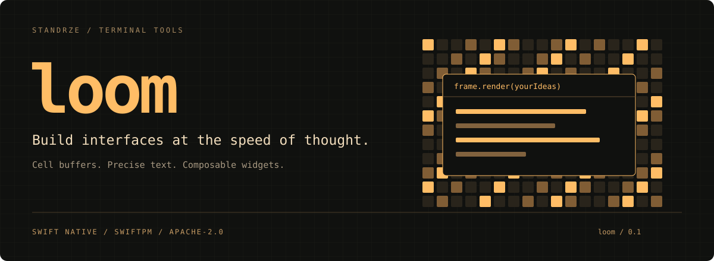

[](https://www.swift.org/)
[](Package.swift)
[](LICENSE)

**A Swift toolkit for expressive terminal interfaces.** Construct a complete frame
from text, layouts, and widgets. loom compares it with the previous frame and
writes the changes through [weft](https://github.com/standrze/weft).

## Documentation

[Getting started](https://swiftloom.dev/docs/loom/) ·
[Stable API reference](https://swiftloom.dev/docs/loom/api/) ·
[Guides and release status](Documentation/README.md)

The current published release is **0.2.1**. This branch also contains the
unreleased [API customization](Documentation/APICustomization.md) increment in
[PR #2](https://github.com/standrze/loom/pull/2). Its repeated list prefixes,
column flex, border-independent titles, per-line alignment, extra plotting
controls, and specialized diff policies are not in the 0.2.1 tag.

## A canvas made of cells

| Layer | What you get |
| --- | --- |
| Rendering | Double-buffered frames, cell diffs, fixed/inline viewports, snapshots, ANSI/headless backends |
| Text | Unicode cell geometry, wrapping, selection, editable documents, undo/redo |
| Content | Markdown rendered with Swift Markdown, styled spans, code blocks |
| Widgets | Lists, tables, panels, gauges, tabs, charts, Canvas, calendar, menus, text inputs, document views |
| Interaction | Stable selection, multiselect, scrolling, focus scopes, key bindings and help |
| Detail | Character art, color blending, symbol animation, terminal color fallbacks |

Your application owns state and event handling. loom owns the frame.

## Add it with SwiftPM

Requires **Swift 6.4+**. CI pins Swift 6.4.1 and validates macOS, Linux under both
C and C.UTF-8 locales, and Windows. Native console sessions and child PTYs are
provided by weft. See [platform support](Documentation/PlatformSupport.md) for
validation details and Windows operation boundaries.

Add the package dependency:

```swift
.package(url: "https://github.com/standrze/loom.git", from: "0.2.1")
```

Then add its product to your target's dependencies:

```swift
.product(name: "loom", package: "loom")
```

The module name is lowercase: `import loom`.

## Draw a frame

```swift
import loom

var terminal = Terminal(backend: ANSIBackend(), width: 80, height: 24)
let greeting = Paragraph(TextLayout("Hello, 世界", width: 80))

try terminal.draw { frame in
    frame.render(greeting, in: frame.area)
    frame.cursor = Point(x: 0, y: 2)
}
```

`draw` rebuilds the logical frame. Unchanged cells do not need to be written again.
For interactive programs, open a `TerminalSession`, process events, resize the
renderer on terminal resize, and close the session on exit. The runnable example
shows that lifecycle:

```sh
swift run loom-demo
```

Type to change the displayed text. Press **Escape** or **Ctrl-C** to exit.
See [the example](Examples/Demo/Demo.swift) and [architecture](Documentation/Architecture.md).

For a searchable table browser with a category list, keyboard/mouse navigation,
multiselect, and modal focus, run `swift run loom-browser`.
See [collections and interaction](Documentation/Collections.md) for the APIs and
[the browser example](Examples/Browser/BrowserApplication.swift) for application-owned event routing.

## Feature showcase

Run `swift run loom-widgets` for progress gauges, tabs, styled top/bottom panel
labels, collection prefixes, column highlighting, and aligned scrollable text.
See [the implementation guide](Documentation/FeatureGapImplementation.md) for
style patches, flexible layout, examples, and the validation record. Press **d**
for custom/merged borders, shadows, measured reverse lists, table margins, and
extended text styles. [Widget and rendering details](Documentation/WidgetRenderingDetails.md)
covers wrapping controls, layout caching/overlap, buffer operations, and the
ANSI/headless backend interface. Press **p** for Sparkline, grouped BarChart,
Cartesian Chart, layered Canvas, and a monthly calendar; see [plotting and calendars](Documentation/Plotting.md).

[Viewport documentation](Documentation/Viewports.md) covers fixed regions,
primary-screen inline output, snapshots, and failure recovery. Run `swift run loom-viewports` for the primary-screen inline example, or add
`--fixed` for a bounded region demonstration. Cursor queries use the published
weft 0.2.1 dependency through the application's existing input reader.

## Development

```sh
scripts/check-format.sh
swift test
swift build --product loom-demo
python3 scripts/smoke.py .build/debug/loom-demo
swift build --product loom-browser
python3 scripts/smoke-browser.py .build/debug/loom-browser
swift build --product loom-widgets
python3 scripts/smoke-widgets.py .build/debug/loom-widgets
swift build --product loom-viewports
python3 scripts/smoke-viewports.py .build/debug/loom-viewports
```

See [CONTRIBUTING.md](CONTRIBUTING.md). loom began as an extraction from
ono-sendai; APIs may change before 1.0. Terminal behavior and character widths
vary between emulators and fonts.

## License

[Apache License 2.0](LICENSE). Dependencies retain their own licenses.
The banner is an original SVG included in this repository under the same license.

## streaming Markdown

Call `MarkdownText.streaming(sourceSoFar)` with the complete source on each update.
The snapshot divides `stableSpans` from `pendingSpans` at a top-level block
boundary: an earlier table is released when another block follows, while the
last table, list, or quote remains mutable. Tables retain their literal appearance.

Snapshots replace previous snapshots; they are not append-only deltas. At response
completion, call `MarkdownText.streaming(sourceSoFar, isComplete: true)` and
rebuild committed output when `requiresFinalReflow` is true. This resolves late
reference definitions, even without a trailing newline. The host owns terminal
scrollback and viewport preservation. The parser currently reparses the whole
source; this API supplies boundaries, not an incremental parsing optimization.
